# AI-Powered Intrusion Detection System — Gated Implementation Workflow

## 1. Delivery rule

Implementation is divided into sequential phases. A phase is not complete because its code was written; it is complete only when its checkpoint passes.

The project follows these rules:

1. Do not begin Phase N+1 until Gate N is marked `PASS`.
2. A failed test sends the work back into the current phase.
3. After a fix, rerun the entire phase gate, not only the failed test.
4. Record the command, result, evidence, and known limitations for every gate.
5. Do not weaken or delete a failing test just to pass a checkpoint.
6. Do not tune the model on the final test split.
7. Keep raw datasets, generated models, secrets, and large reports out of Git.
8. Any intentional scope or acceptance-criteria change must be documented before rerunning the gate.

Checkpoint states:

```text
NOT_STARTED -> IN_PROGRESS -> TESTING -> PASS
                     |           |
                     +-> BLOCKED  +-> FAIL -> IN_PROGRESS
```

Only `PASS` unlocks the next phase.

## 2. End-to-end workflow

```mermaid
flowchart TD
    P0[Phase 0: scope and contracts] --> G0{Gate 0 passes?}
    G0 -- No --> P0
    G0 -- Yes --> P1[Phase 1: repository foundation]
    P1 --> G1{Gate 1 passes?}
    G1 -- No --> P1
    G1 -- Yes --> P2[Phase 2: dataset acquisition and audit]
    P2 --> G2{Gate 2 passes?}
    G2 -- No --> P2
    G2 -- Yes --> P3[Phase 3: preprocessing and split pipeline]
    P3 --> G3{Gate 3 passes?}
    G3 -- No --> P3
    G3 -- Yes --> P4[Phase 4: baselines]
    P4 --> G4{Gate 4 passes?}
    G4 -- No --> P4
    G4 -- Yes --> P5[Phase 5: selected model and artifact]
    P5 --> G5{Gate 5 passes?}
    G5 -- No --> P5
    G5 -- Yes --> P6[Phase 6: inference API]
    P6 --> G6{Gate 6 passes?}
    G6 -- No --> P6
    G6 -- Yes --> P7[Phase 7: frontend against fixtures]
    P7 --> G7{Gate 7 passes?}
    G7 -- No --> P7
    G7 -- Yes --> P8[Phase 8: full-stack integration]
    P8 --> G8{Gate 8 passes?}
    G8 -- No --> P8
    G8 -- Yes --> P9[Phase 9: security and resilience]
    P9 --> G9{Gate 9 passes?}
    G9 -- No --> P9
    G9 -- Yes --> P10[Phase 10: performance and deployment]
    P10 --> G10{Gate 10 passes?}
    G10 -- No --> P10
    G10 -- Yes --> P11[Phase 11: documentation and release]
    P11 --> G11{Release gate passes?}
    G11 -- No --> P11
    G11 -- Yes --> DONE[MVP release candidate]
```



## 3. Standard command interface

As the repository is scaffolded, provide a stable command interface so validation does not depend on remembering package-specific commands.

Planned top-level commands:

| Command | Purpose |
|---|---|
| `make setup` | Install or verify development dependencies |
| `make format-check` | Check formatting without modifying files |
| `make lint` | Run Python, TypeScript, and configuration linters |
| `make typecheck` | Run Python and TypeScript static type checks |
| `make test-ml` | Run data and ML unit tests |
| `make test-api` | Run backend unit and integration tests |
| `make test-web` | Run frontend unit and component tests |
| `make test-e2e` | Run browser tests against the integrated stack |
| `make security` | Run dependency, secret, and container checks |
| `make build` | Build backend and frontend production artifacts |
| `make smoke` | Start the stack and run health/inference smoke tests |
| `make test` | Run all tests that do not require the full raw dataset |
| `make release-check` | Run the complete release gate |

Each phase can add `make gate-N`, but every gate must ultimately call the same underlying commands used in CI. Gate scripts must exit nonzero when any required check fails.

## 4. Checkpoint evidence

Store a short record for every completed checkpoint under:

```text
reports/checkpoints/phase-NN/summary.md
```

Generated bulky outputs can remain ignored, but the summary should be committed. Each summary must contain:

```markdown
# Phase N checkpoint

- Status: PASS | FAIL | BLOCKED
- Date:
- Commit:
- Environment:
- Commands run:
- Automated test result:
- Manual checks performed:
- Evidence files:
- Known limitations:
- Decision: proceed | remain in phase
```

Minimum evidence for a `PASS`:

- exact commands and exit status;
- test counts and failures/skips;
- relevant metric or benchmark files;
- screenshots for visual gates;
- the Git commit that was tested; and
- no unresolved severity-high issue within the phase scope.

## 5. Phase summary

| Phase | Output | Blocking checkpoint |
|---|---|---|
| 0. Scope and contracts | Agreed requirements and architecture decisions | No unresolved MVP or data-contract decision |
| 1. Foundation | Runnable project skeleton and CI basics | All smoke, lint, type, and starter tests pass |
| 2. Data audit | Reproducible dataset inventory and quality report | Source integrity and data assumptions verified |
| 3. Data pipeline | Deterministic cleaned data and frozen split | Leakage, overlap, schema, and determinism tests pass |
| 4. Baselines | Honest minimum model performance | Baseline report reproducible on validation data |
| 5. Final model | Calibrated, versioned inference artifact | Model acceptance and artifact parity tests pass |
| 6. API | Safe prediction and metadata endpoints | API contract and negative-input tests pass |
| 7. Frontend fixtures | Complete UI using fixed API fixtures | Component, accessibility, and visual checks pass |
| 8. Integration | UI and API operating together | Real upload-to-export browser journey passes |
| 9. Hardening | Security and failure handling | Abuse, secrets, dependency, and resilience checks pass |
| 10. Deployment | Reproducible containers and measured performance | Clean-build, benchmark, and smoke checks pass |
| 11. Release | Documented portfolio-ready MVP | Full release check passes from a clean checkout |

## 6. Detailed phases and gates

### Phase 0 — Scope, contracts, and engineering decisions

**Objective:** remove ambiguous product and technical decisions before implementation.

**Work:**

- Confirm the MVP is batch flow-feature analysis, not live packet capture.
- Freeze the initial attack-family taxonomy.
- Define supported input format, required features, maximum rows, and maximum file size.
- Define binary and attack-family output fields.
- Confirm the two-stage model design.
- Define primary evaluation split and model acceptance targets.
- Define retention policy: uploads are not retained or logged by default.
- Record architecture decisions for Python version, package manager, React toolchain, artifact format, and Docker topology.
- Create the initial API schema examples before backend or frontend coding.

**Required documents:**

- `PROJECT_PLAN.md`
- `IMPLEMENTATION_WORKFLOW.md`
- `docs/decisions/0001-mvp-scope.md`
- `docs/decisions/0002-data-and-label-contract.md`
- `docs/decisions/0003-model-evaluation.md`
- `docs/api-contract.md`

**Gate 0 tests:**

- Every user-visible prediction field has a name, type, and meaning.
- Every supported attack family maps from one or more source labels.
- Unsupported and low-confidence behavior is documented.
- The model metrics name the split and threshold they use.
- Frontend and backend examples use the same field names.
- Markdown links and Mermaid syntax validate.

**Pass criteria:**

- No unresolved decision changes the dataset pipeline, artifact shape, API contract, or primary UI journey.
- All required documents exist and agree with each other.
- A Gate 0 checkpoint summary is recorded.

**Do not proceed if:** the taxonomy, feature contract, or definition of a suspicious prediction is still undecided.

---

### Phase 1 — Repository and toolchain foundation

**Objective:** create a reproducible skeleton before adding domain logic.

**Work:**

- Create the planned `ml/`, `backend/`, `frontend/`, `data/`, `models/`, `docs/`, and `reports/` structure.
- Add `.gitignore`, `.env.example`, dependency lockfiles, and license.
- Configure Python formatting, linting, typing, and pytest.
- Configure React, TypeScript, formatting, linting, and unit tests.
- Add a minimal FastAPI `/health` endpoint.
- Add a minimal React application that can call or display backend health.
- Add initial Dockerfiles and Docker Compose services.
- Add a root `Makefile` implementing the standard commands available so far.
- Add CI jobs for formatting, linting, typing, unit tests, and builds.

**Gate 1 automated tests:**

```bash
make format-check
make lint
make typecheck
make test
make build
docker compose config --quiet
make smoke
```

**Gate 1 manual checks:**

- Start from a fresh local environment using only documented setup steps.
- Open the frontend and verify the health state is visible.
- Confirm browser and API logs contain no uncaught error.
- Stop and restart the stack to verify reproducibility.

**Pass criteria:**

- Every Gate 1 command exits successfully.
- The API health check returns the documented response.
- The production frontend build loads without console errors.
- Docker services become healthy and stop cleanly.
- CI performs the same checks and is green.

**Do not proceed if:** local success depends on unrecorded global packages, secrets, or files.

---

### Phase 2 — Dataset acquisition and audit

**Objective:** understand and verify CIC-IDS2017 before transforming or modeling it.

**Work:**

- Document the official source and download procedure.
- Keep the full dataset under `data/raw/`, ignored by Git.
- Create a checksum and source manifest without committing dataset contents.
- Inventory files, columns, row counts, labels, and capture-day provenance.
- Measure duplicates, missing values, infinities, constants, and class imbalance.
- Identify likely leakage fields and lab-specific identifiers.
- Create small synthetic test fixtures with the same schema.
- Generate a human-readable data audit report.

**Gate 2 automated tests:**

- Expected source files are present locally or the audit reports exactly what is missing.
- Checksums match the recorded local manifest.
- Column normalization can read every source CSV.
- Labels and their source files are inventoried.
- No raw dataset file is tracked by Git.
- Synthetic fixtures contain no real sensitive network identifiers.
- Audit generation is deterministic for the same inputs.

**Gate 2 manual checks:**

- Review the label distribution and rare classes.
- Review duplicate and non-finite counts.
- Review the proposed leakage exclusions.
- Confirm licensing/citation instructions are recorded.

**Pass criteria:**

- The complete dataset can be audited with one documented command.
- The audit accounts for every file and label used by the project.
- Raw data is not committed.
- Data-quality problems have an explicit treatment planned for Phase 3.

**Do not proceed if:** source provenance, file identity, label meaning, or schema differences remain unexplained.

---

### Phase 3 — Deterministic preprocessing and split pipeline

**Objective:** produce leak-resistant training, validation, and final-test inputs.

**Work:**

- Implement canonical column names and numeric parsing.
- Replace infinities with missing values and implement train-fitted imputation.
- Deduplicate before splitting and record removed counts.
- Implement the versioned source-label-to-attack-family mapping.
- Exclude identifiers and selected leakage-prone features.
- Generate group/day-aware train, validation, and final-test manifests.
- Ensure all preprocessing state is learned from training data only.
- Save a versioned feature schema.
- Produce summary statistics per split.

**Gate 3 automated tests:**

- Column normalization and label mapping have unit coverage.
- Running the pipeline twice with the same seed creates identical split manifests.
- No row/group identifier overlaps across splits.
- No duplicate feature/label row crosses split boundaries.
- The final-test split is never used by fitting code.
- Every output feature is finite after transformation.
- Feature order and data types match the saved schema.
- Unknown source labels fail loudly instead of being silently reassigned.
- Class support for every split is reported.

**Gate 3 review checks:**

- Compare a random split only as a diagnostic; do not use it as the headline result.
- Review whether rare classes should remain separate or enter `RARE_OTHER`.
- Review results with and without port features before freezing the feature set.

**Pass criteria:**

- The preprocessing pipeline is deterministic and covered by tests.
- Split leakage and group overlap tests report zero violations.
- The feature and label contracts are frozen for the first modeling cycle.
- Split manifests and their hashes are recorded.

**Do not proceed if:** the final-test data influenced feature selection, thresholds, or preprocessing decisions.

---

### Phase 4 — Baselines and evaluation harness

**Objective:** establish honest reference performance and prove the evaluation code.

**Work:**

- Implement one evaluation entry point used by every model.
- Train a dummy binary classifier.
- Train a logistic-regression binary baseline.
- Train a simple attack-family baseline on malicious training rows.
- Report precision, recall, F1, PR AUC, ROC AUC, false-positive rate, and confusion matrix.
- Report macro/weighted F1 and per-class support for attack families.
- Add calibration metrics even if baseline confidence is poor.
- Record training time, inference time, and artifact size.

**Gate 4 automated tests:**

- Metric calculations pass tests built from small known examples.
- Confusion-matrix label order is stable.
- Divisions by zero and absent-class cases are handled explicitly.
- Training is reproducible within an agreed tolerance.
- Serialized and reloaded baselines return equivalent predictions.
- Reports clearly distinguish validation from final-test results.

**Pass criteria:**

- A single command recreates the baseline report from the frozen split.
- Logistic regression is compared with the dummy baseline using the same rows and metrics.
- Evaluation failures cannot be hidden by accuracy alone.
- No final model has been selected using final-test performance.

**Do not proceed if:** the evaluation harness produces inconsistent results or omits class support and false-positive behavior.

---

### Phase 5 — Model selection, calibration, and artifact freeze

**Objective:** select and package the model that the application will serve.

**Work:**

- Train a class-weighted Random Forest binary detector.
- Train the Random Forest attack-family classifier.
- Optionally train XGBoost using the identical splits and evaluation harness.
- Tune hyperparameters on training/validation data only.
- Select the malicious operating threshold from validation data.
- Calibrate probabilities on separate validation data.
- Compare supported feature variants, including the documented port-feature experiment.
- Select the model using security-relevant metrics, inference cost, artifact size, and calibration.
- Evaluate the selected frozen pipeline once on the untouched final-test split.
- Save preprocessing, models, thresholds, taxonomy, and metadata as one versioned artifact bundle.
- Write `docs/model-card.md`.

**Gate 5 automated tests:**

- Artifact loading verifies version, schema hash, and required metadata.
- Reloaded predictions match pre-serialization predictions within tolerance.
- Shuffled input columns are reordered safely or rejected clearly.
- Missing/extra feature behavior matches the contract.
- Confidence values are finite and within `[0, 1]`.
- Batch and one-row inference produce equivalent results.
- The final-test report is generated only after selection is frozen.
- A model regression test protects agreed key metrics.

**Gate 5 model acceptance:**

- Binary detector beats both baselines on the primary holdout.
- Initial target: malicious recall at least `0.90` with false-positive rate at most `0.03`.
- Initial target: attack-family macro F1 at least `0.75` for retained supported classes.
- Every metric includes its threshold, split, and sample support.
- Calibration results are reported and low-confidence behavior is configured.

If a target is missed, revise the taxonomy, feature contract, or target transparently, then repeat the affected earlier gate. Do not silently lower the target after seeing final-test results.

**Pass criteria:**

- Exactly one artifact bundle is named as the MVP candidate.
- Model card, evaluation report, feature schema, label map, and artifact manifest agree.
- Gate 5 tests and acceptance checks pass.

**Do not proceed if:** the API team would need to guess feature order, thresholds, labels, or artifact version.

---

### Phase 6 — FastAPI inference service

**Objective:** expose the frozen model through a safe, versioned API.

**Work:**

- Load and validate the model artifact at startup.
- Implement `/health`, `/api/v1/model`, and `/api/v1/input-template`.
- Implement JSON and CSV prediction endpoints.
- Implement strict schema, size, row-count, and numeric validation.
- Return row predictions, aggregates, warnings, and model version.
- Add structured errors with stable codes.
- Add correlation IDs and privacy-safe logging.
- Configure CORS from the environment.
- Generate OpenAPI examples from the real schemas.

**Gate 6 automated tests:**

- Unit tests cover validation and result formatting.
- Integration tests use the real frozen artifact.
- Contract tests compare actual responses to documented examples.
- Tests cover empty files, wrong type, duplicate headers, missing/extra columns, invalid numbers, infinities, too many rows, and oversized requests.
- Model-unavailable startup and inference failures return safe errors without tracebacks.
- JSON and CSV versions of the same rows return equivalent predictions.
- Logs do not contain full uploaded row values.
- Health endpoints correctly distinguish process health from model readiness.

**Gate 6 manual checks:**

- Inspect generated OpenAPI documentation.
- Upload the approved sample file through the API documentation page.
- Confirm errors are understandable without server-log access.

**Pass criteria:**

- All API tests pass against the candidate artifact.
- OpenAPI output matches `docs/api-contract.md`.
- The service rejects unsafe or invalid input predictably.
- Backend container health and graceful shutdown work.

**Do not proceed if:** model/schema mismatch can produce a prediction instead of an error.

---

### Phase 7 — React frontend against fixed fixtures

**Objective:** complete and test the user experience before live integration adds variability.

**Frontend requirement:** load and follow the installed `design-taste-frontend` skill before design or implementation. Apply its full workflow to any public-facing landing/upload entry surface. Its own scope excludes dashboards/app screens, so preserve dense analyst usability while applying the skill's generally relevant visual-review discipline to the dashboard.

**Work:**

- Define the visual direction, tokens, typography, spacing, and responsive behavior.
- Build the upload state, template link, validation summary, and limitations copy.
- Build summary metrics, attack distribution, confidence distribution, results table, filters, pagination, and row detail.
- Build loading, empty, success, low-confidence, partial-validation, and failure states.
- Build model/version information and privacy notices.
- Implement enriched CSV export with formula-prefix neutralization.
- Develop against versioned API fixtures that include normal, mixed, invalid, and edge-case responses.

**Gate 7 automated tests:**

- Type checking, linting, unit tests, and production build pass.
- Component tests cover every upload/result state.
- Summary values match fixture rows.
- Filters, sorting, pagination, and row details behave correctly.
- Exported results match the selected specification.
- Keyboard interaction works for upload, filters, table controls, and dialogs.
- Automated accessibility checks report no serious violation.

**Gate 7 browser review:**

- Review at approximately `375px`, `768px`, and `1440px` widths.
- Capture screenshots for upload, results, row-detail, empty, and error states.
- Confirm no clipping, overlap, unintended horizontal page scrolling, or unreadable chart labels.
- Confirm focus indicators, contrast, reduced-motion behavior, and non-color status cues.
- Confirm no browser-console errors or warnings owned by the application.
- Perform the taste-skill look-and-fix review where its scope applies and record what changed.

**Pass criteria:**

- All required states work using fixtures.
- The public-facing entry surface passes the selected taste-skill direction and review.
- The dashboard remains information-dense, accessible, and responsive.
- Screenshot evidence and accessibility results are attached to Gate 7.

**Do not proceed if:** the UI only works for the happy-path fixture or requires the live API to render testable states.

---

### Phase 8 — Full-stack integration and end-to-end workflow

**Objective:** connect the tested frontend to the tested API and verify the real user journey.

**Work:**

- Replace fixture transport with the generated API client or typed adapter.
- Configure development and container API base URLs.
- Connect upload, validation errors, predictions, metadata, template download, and export.
- Add request cancellation, timeout behavior, and duplicate-submit prevention.
- Provide a safe sample input and known expected result assertions.

**Gate 8 end-to-end scenarios:**

1. Start the stack from clean containers.
2. Open the frontend and verify model readiness.
3. Download the input template.
4. Upload a valid mixed sample.
5. Verify totals, suspicious count, categories, confidence, and model version.
6. Filter suspicious rows and open a row detail.
7. Export results and validate the exported header and row count.
8. Upload an invalid-schema file and verify actionable feedback.
9. Upload an over-limit file and verify safe rejection.
10. Restart the API and verify the UI handles temporary unavailability and recovery.

**Gate 8 automated tests:**

```bash
make test
make build
make smoke
make test-e2e
```

**Pass criteria:**

- The complete upload-to-export path passes using the real model and API.
- No fixture-only field or mocked transport remains in the production path.
- Frontend, API, and model versions are visible and consistent.
- Browser and service logs contain no unexpected error.

**Do not proceed if:** unit/component tests pass but the integrated user journey fails.

---

### Phase 9 — Security, privacy, and resilience hardening

**Objective:** verify the application behaves safely under malformed and hostile input.

**Work:**

- Enforce CSV type/content validation, size, rows, columns, and time limits.
- Ensure temporary files are avoided or reliably removed.
- Neutralize spreadsheet formulas in exported user-controlled values.
- Restrict CORS and remove debug configuration.
- Run backend and frontend containers as non-root.
- Pin dependencies and generate vulnerability reports.
- Add secret scanning and verify `.env` files are ignored.
- Add request IDs, safe error logs, and resource-exhaustion protections.
- Document the sensitivity of network metadata.

**Gate 9 tests:**

- Fuzz or property tests cover malformed CSV structures and numeric values.
- Formula-injection fixtures export as inert text.
- Path-like filenames cannot escape upload handling.
- Oversized/decompression-bomb-style inputs are rejected within resource limits.
- Unexpected model files cannot be uploaded or loaded.
- Secrets scan reports no committed credential.
- Dependency and image scans contain no unresolved critical/high issue, or an explicit time-bounded exception is documented.
- Runtime container user is non-root.
- Upload contents are absent from normal logs and removed after the request.

**Pass criteria:**

- `make security` passes.
- Negative-input tests pass without process crashes or data retention.
- Security limitations and accepted residual risks are documented.

**Do not proceed if:** malformed input can crash the service, exhaust resources beyond configured limits, leak rows, or execute spreadsheet formulas after export.

---

### Phase 10 — Performance, containers, and reproducibility

**Objective:** prove that a reviewer can build and run the project predictably.

**Work:**

- Finalize production multi-stage Dockerfiles.
- Pin base images and runtime versions.
- Add container health checks and resource guidance.
- Benchmark startup, one-row inference, and maximum supported batch inference.
- Measure memory, image size, and response size.
- Verify deterministic artifact metadata and dependency locks.
- Test the documented clean-clone workflow.

**Provisional performance budgets:**

- Health/readiness becomes available within a documented startup budget.
- A supported `10,000`-row batch completes within `10 seconds` on the documented reference machine.
- No accepted request exceeds the configured memory limit.
- Frontend production assets load without an avoidable multi-megabyte bundle.

Budgets can be revised before Gate 10 only when accompanied by measured evidence and updated documentation.

**Gate 10 tests:**

- Build containers with no local dependency cache assumed.
- Start with only `.env.example`-documented configuration.
- Run five benchmark repetitions and report median and p95.
- Run concurrent requests at the supported demo level and verify no incorrect cross-request data.
- Stop/restart containers and repeat the smoke path.
- Run the project from a clean checkout without untracked files.
- Verify the repository contains no raw dataset or generated secret.

**Pass criteria:**

- Clean build, smoke, and end-to-end checks pass.
- Performance budgets pass on the named reference environment.
- Benchmark and image metadata are recorded.
- Setup documentation contains every required command and variable.

**Do not proceed if:** the application only works with developer-local files, mutable dependency versions, or an undocumented model path.

---

### Phase 11 — Documentation, demonstration, and release candidate

**Objective:** package the verified system into a clear, honest, reproducible portfolio project.

**Work:**

- Complete README setup, architecture, training, API, UI, and troubleshooting sections.
- Finalize the model card and dataset citations.
- Document measured metrics without overstating production performance.
- Add architecture/data-flow diagrams and approved screenshots.
- Add API examples and a safe demo CSV.
- Record supported browsers and reference environment.
- Review licenses and third-party notices.
- Prepare a short demonstration script.
- Create a release checklist and changelog entry.

**Final release gate:**

```bash
make format-check
make lint
make typecheck
make test
make build
make security
make smoke
make test-e2e
make release-check
```

**Final manual journey:**

- Follow the README from a clean checkout.
- Build and start the stack.
- Upload the included sample.
- Explain one suspicious result, its confidence, model version, and limitation.
- Filter and export results.
- Stop the stack and confirm no upload remains.
- Review the repository as a first-time evaluator.

**Release pass criteria:**

- Every earlier checkpoint is `PASS` for the release commit.
- All final gate commands pass without undocumented skips.
- README instructions work from a clean checkout.
- The demo uses the same artifact and containers described in documentation.
- Model limitations, dataset limitations, and non-production status are visible.
- The final checkpoint summary names the exact release commit.

The output is an MVP release candidate. Any later feature starts a new gated cycle rather than modifying the verified release without retesting.

## 7. Failure and rollback workflow

When a checkpoint fails:

1. Mark the checkpoint `FAIL` and record the failing command and evidence.
2. Classify the cause as requirements, data, model, API, UI, infrastructure, security, or documentation.
3. Return to the earliest phase whose contract is invalid.
4. Fix the cause and add or improve a regression test.
5. Rerun that phase's complete gate.
6. Rerun every downstream gate affected by the changed contract or artifact.
7. Proceed only when all affected gates return to `PASS`.

Examples:

- A label-mapping bug found in Phase 6 returns to Phase 3, then repeats Phases 4–6.
- A confidence-calibration problem found in the UI returns to Phase 5, then repeats API contract and integration gates.
- A visual-only issue found in Phase 8 returns to Phase 7, then repeats Gate 7 and Gate 8.
- A dependency vulnerability with no safe patch may block Phase 9 or require a documented dependency replacement and downstream retest.

## 8. Change-control rules after a gate passes

Changes are categorized by the earliest affected gate:

| Change | Return to at least |
|---|---|
| Attack taxonomy or feature set | Phase 3 |
| Data split or preprocessing | Phase 3 |
| Model type, threshold, or calibration | Phase 5 |
| Prediction response shape | Phase 6 |
| UI behavior or visual direction | Phase 7 |
| Service wiring or environment variables | Phase 8 |
| Upload limits, CORS, logging, dependencies | Phase 9 |
| Containers or performance budgets | Phase 10 |
| Documentation-only correction | Phase 11, unless it exposes an earlier defect |

No previously passed checkpoint is assumed valid after a change to its inputs.

## 9. Recommended working rhythm

For each phase:

1. Read the phase objective and gate before writing code.
2. Create the smallest vertical change needed for one testable behavior.
3. Run focused tests continuously.
4. Keep the branch green before adding the next behavior.
5. Run the full phase gate when the phase work is complete.
6. Fix failures and rerun the full gate.
7. Write the checkpoint summary.
8. Commit the verified state.
9. Begin the next phase only after `PASS`.

This rhythm makes every phase a stable recovery point and prevents later frontend or deployment work from hiding weaknesses in the data and model foundations.
