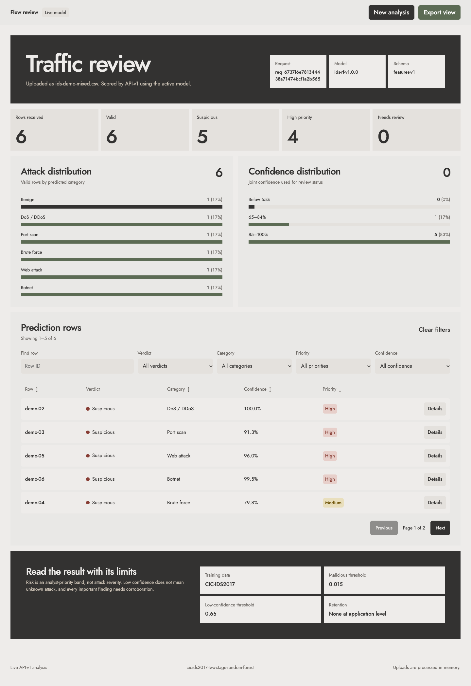
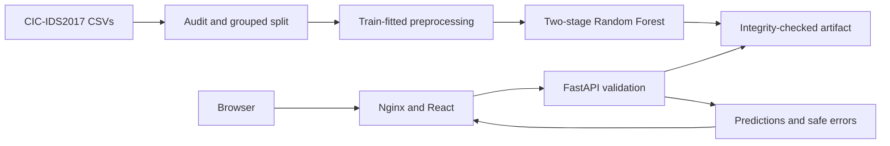

# AI-Powered Intrusion Detection System

A full-stack machine-learning project that classifies network-flow records as benign or suspicious and categorizes supported attacks. Its audited CIC-IDS2017 pipeline, calibrated Random Forest artifact, versioned FastAPI service, live React review workflow, security-hardened runtime, and reproducible deployment have passed all eleven implementation phases. Version `0.1.0` is the verified MVP release candidate.

> This is an educational batch-analysis demo, not a packet sniffer, autonomous blocker,
> production IDS, or SIEM replacement. Predictions require analyst review and describe
> behavior learned from a controlled 2017 dataset.



## Current capabilities

- FastAPI service with liveness, readiness, metadata, input-template, JSON prediction, and CSV upload endpoints.
- React and TypeScript upload, triage, row-detail, filtering, and export workflow connected to the live API.
- Safe six-row browser demo with known model assertions and no network identifiers.
- Python and frontend formatting, linting, typing, and test commands.
- Docker Compose development/demo stack.
- Versioned product, data, model, and API contracts.
- Streaming CIC-IDS2017 audit, global deduplication, grouped splits, and train-fitted preprocessing.
- Validation-only dummy and streaming logistic baselines with explicit class, error-rate, and calibration metrics.
- Group-aware Random Forest selection, deterministic calibration, and integrity-checked artifact packaging.
- Strict batch validation, partial-success row errors, correlation IDs, privacy-safe logs, and environment-scoped CORS.
- Hostile-input limits and processing deadlines, formula-safe exports, read-only non-root containers, locked dependency audits, secret scanning, and image scanning.
- Digest-pinned multi-stage images, explicit CPU/memory/PID limits, offline frontend assets, and clean-checkout performance benchmarking.

The API verifies every file in `models/ids-rf-v1/` at startup. `/health` remains a process-liveness check; `/ready` returns `200` only after the model is integrity-checked and compatible.

## Architecture



The browser sends a bounded CSV or JSON batch to FastAPI. The API validates the schema,
scores valid rows with the read-only artifact, and returns predictions without retaining
the upload. Training inputs and generated artifacts remain outside Git. See the
[architecture and data-flow guide](docs/architecture.md) for component, trust-boundary,
and deployment diagrams.

## Dataset audit

Phase 2 uses the eight machine-learning CSV files from CIC-IDS2017. Follow the verified acquisition, citation, checksum, and extraction procedure in [the dataset guide](docs/data/cic-ids2017.md). Raw data and generated reports stay local and are ignored by Git.

After extracting the archive:

```bash
make data-manifest RETRIEVED_AT=YYYY-MM-DD
make audit-data
```

The audit streams the full dataset, verifies every file checksum, inventories labels and schemas, and measures missing, non-finite, constant, and duplicate data without loading all rows into memory.

Build and verify the grouped train, validation, and untouched final-test inputs with:

```bash
make gate-3
```

See [the frozen preprocessing contract](docs/data/preprocessing-v1.md) for grouping, leakage controls, feature schema, and rare-class limitations.

Train and evaluate the reproducible validation baselines with:

```bash
make gate-4
```

The [baseline guide](docs/ml/baselines-v1.md) documents the metrics and the sealed final-test boundary.

Tune the Random Forest candidates without opening final-test predictions with:

```bash
make model-selection-report
```

After the selection in `configs/model-selection-v1.json` is frozen, `make gate-5` creates or verifies the single versioned MVP artifact. See the [model-selection guide](docs/ml/model-selection-v1.md) and [model card](docs/model-card.md).

## Prerequisites

Choose either:

- Docker with Docker Compose; or
- Python 3.12, [uv](https://docs.astral.sh/uv/), Node.js 24 LTS, and npm.

The production model is deliberately not stored in Git. A runnable checkout needs the
exact six-file `ids-rf-v1.0.0` artifact produced by `make finalize-model`, either at
`models/ids-rf-v1/` or at the absolute directory named by `IDS_MODEL_HOST_DIR`. Do not
load a `joblib` artifact from an untrusted source.

## Quick start with Docker

```bash
git clone https://github.com/adil-ech/AI-Powered-Intrusion-Detection-System.git
cd AI-Powered-Intrusion-Detection-System
cp .env.example .env
# Place the trusted artifact at models/ids-rf-v1/, or set IDS_MODEL_HOST_DIR.
docker compose up --build --detach --wait
```

Open <http://localhost:8080>, choose **Review included sample**, and expect six valid
rows: one benign and five suspicious across DoS/DDoS, port scan, brute force, web
attack, and botnet. Stop and remove the stateless services with:

```bash
docker compose down --remove-orphans
```

The [five-minute demonstration script](docs/demo-script.md) explains one result,
filtering, export, model identity, and the product limitations.

## Local development

```bash
cp .env.example .env
make setup
make test
make build
```

Run the API:

```bash
PYTHONPATH=ml/src uv run uvicorn backend.app.main:app --reload
```

Run the frontend in another terminal. Copy `frontend/.env.example` to `frontend/.env.local` first only when you need to override its routing:

```bash
npm --prefix frontend run dev
```

The development frontend is available at <http://localhost:5173> and proxies readiness and API calls to <http://localhost:8000>.

## Docker

```bash
cp .env.example .env
docker compose up --build
```

`IDS_MODEL_HOST_DIR` defaults to `./models/ids-rf-v1`. Set it to the absolute path of
an integrity-checked artifact directory when the model is stored outside the checkout.

- Application: <http://localhost:8080>
- API documentation: <http://localhost:8000/docs>
- API liveness: <http://localhost:8000/health>
- Model readiness: <http://localhost:8000/ready>
- Input template: <http://localhost:8000/api/v1/input-template>

Stop the stack with:

```bash
docker compose down --remove-orphans
```

## API examples

Inspect the loaded model and thresholds:

```bash
curl --fail --silent http://localhost:8000/api/v1/model | python3 -m json.tool
```

Submit the bundled safe sample:

```bash
curl --fail --silent \
  -F "file=@frontend/public/samples/ids-demo-mixed.csv;type=text/csv" \
  http://localhost:8000/api/v1/predictions/file | python3 -m json.tool
```

The response should report `6` valid rows, `5` suspicious rows, model version
`ids-rf-v1.0.0`, and no row errors. Full JSON/CSV schemas, limits, and error behavior
are documented in the [inference API guide](docs/api-inference-v1.md); interactive
OpenAPI documentation is served at <http://localhost:8000/docs>.

## Measured model and runtime behavior

On the sealed final-test split, malicious recall was `0.999616`, false-positive rate
was `0.009323`, and observed-family macro F1 was `0.918035`. `INFILTRATION` recall was
only `0.375` on eight examples, while `RARE_OTHER` had no honest test support. These
in-dataset measurements must not be interpreted as contemporary-network guarantees.

On the Phase 10 arm64 reference host, 10,000-row inference had a `0.905s` p95 over five
runs, API memory peaked at `228.60 MiB`, and clean startup took `12.128s`. See the
[model card](docs/model-card.md) and [performance report](reports/checkpoints/phase-10/performance-report.md)
for the complete metrics, supports, method, and limitations.

## Quality commands

```bash
make format-check
make lint
make typecheck
make test
make build
docker compose config --quiet
make smoke
make test-e2e
make gate-8
make security
make gate-9
make performance
make gate-10
make release-check
make gate-11
make clean
```

`make smoke` creates response files in a temporary directory, always removes that directory, and shuts down its Compose services before exiting.

`make gate-8` validates every repository contract, runs the ML, API, and frontend suites, builds both application layers, smoke-tests the Compose stack, and drives the complete upload-to-export browser journey against the real ignored model artifact. See the [Phase 8 integration guide](docs/frontend/phase-08-integration.md).

`make security` runs negative-input/export tests and the locked dependency, Git history, working-tree, container-user, and high/critical image scans. It requires Docker and internet access to current advisory databases; scanner images are pinned. See the [security and privacy guide](docs/security-privacy.md) for the trust boundaries, data handling guarantees, and accepted residual risks.

`make performance` requires a clean committed checkout. It rebuilds without Docker
cache from a temporary archive of `HEAD`, benchmarks five one-row and five maximum-row
requests, verifies concurrent isolation, records memory/image/response/asset sizes, and
restarts the stack. See the [deployment and performance guide](docs/deployment-performance.md)
for the resource envelope, model-path contract, benchmark method, and budgets.

`make release-check` requires a clean committed checkout and the trusted model
artifact. It verifies the final documentation contract, all earlier PASS checkpoints,
Compose configuration, repository boundaries, safe sample, and exact artifact hashes.
`make gate-11` runs the complete release sequence.

## Supported environment and browsers

- Reference host: macOS 26.2 arm64, Docker 29.8.2, Python 3.12.14, uv 0.12.21,
  Node 25.2.1, and npm 11.6.2.
- Container toolchains: Python 3.12 slim and Node 24 Alpine, pinned by digest.
- Browser release gate: current Chromium through Playwright at desktop, tablet, and
  mobile widths. Current Chrome and Chromium-based Edge are the supported demo
  browsers. Firefox and Safari are expected to work but are not release-certified.

## Troubleshooting

| Symptom | Check |
|---|---|
| API stays unhealthy | Confirm the six model files exist, `manifest.json` hashes match, and `IDS_MODEL_HOST_DIR` is an absolute trusted path when outside the repository. |
| Port 8000 or 8080 is busy | Change `API_PORT` or `FRONTEND_PORT` in `.env`, then recreate the stack. |
| Frontend reports model unavailable | Open `/ready`, inspect `docker compose logs api`, and confirm the frontend and API use the same Compose project. |
| CSV is rejected | Start from `/api/v1/input-template`; keep all 63 required numeric features and stay under 10 MiB and 10,000 rows. |
| Browser tests cannot launch | Run `npx --prefix frontend playwright install chromium`. |
| Security checks cannot refresh | Restore registry/advisory network access and rerun; the release gate does not silently skip audits. |
| Local output should be removed | Run `docker compose down --remove-orphans` followed by `make clean`. |

## Project contracts

- [Project plan](PROJECT_PLAN.md)
- [Gated implementation workflow](IMPLEMENTATION_WORKFLOW.md)
- [API contract](docs/api-contract.md)
- [Architecture and data flow](docs/architecture.md)
- [Model card](docs/model-card.md)
- [Demonstration script](docs/demo-script.md)
- [Release checklist](docs/release-checklist.md)
- [Changelog](CHANGELOG.md)
- [Architecture decisions](docs/decisions/README.md)
- [Phase checkpoints](reports/checkpoints/)

## Data and models

The full CIC-IDS2017 dataset and generated model artifacts are intentionally excluded from Git. See [data/README.md](data/README.md) and [models/README.md](models/README.md) before adding local files.

## License and notices

Project code is MIT licensed. See [LICENSE](LICENSE),
[third-party notices](THIRD_PARTY_NOTICES.md), and the
[CIC-IDS2017 citation and acquisition guide](docs/data/cic-ids2017.md).
