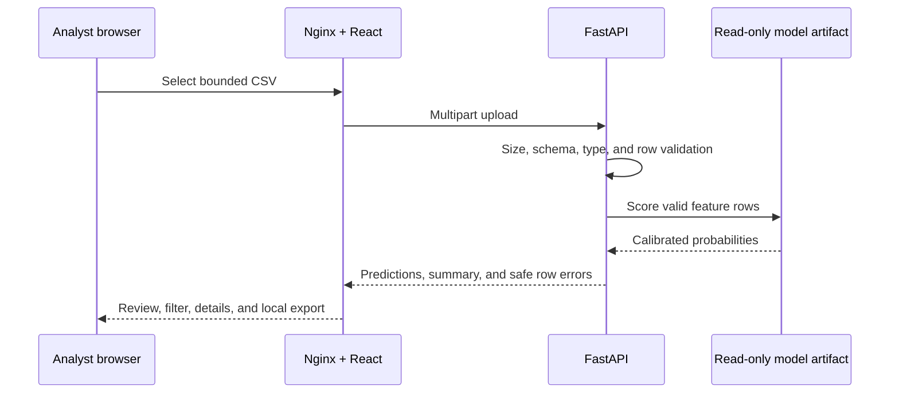
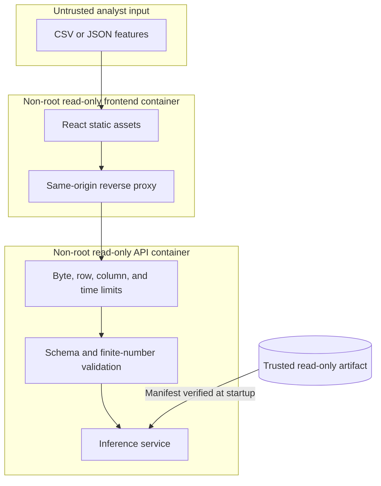
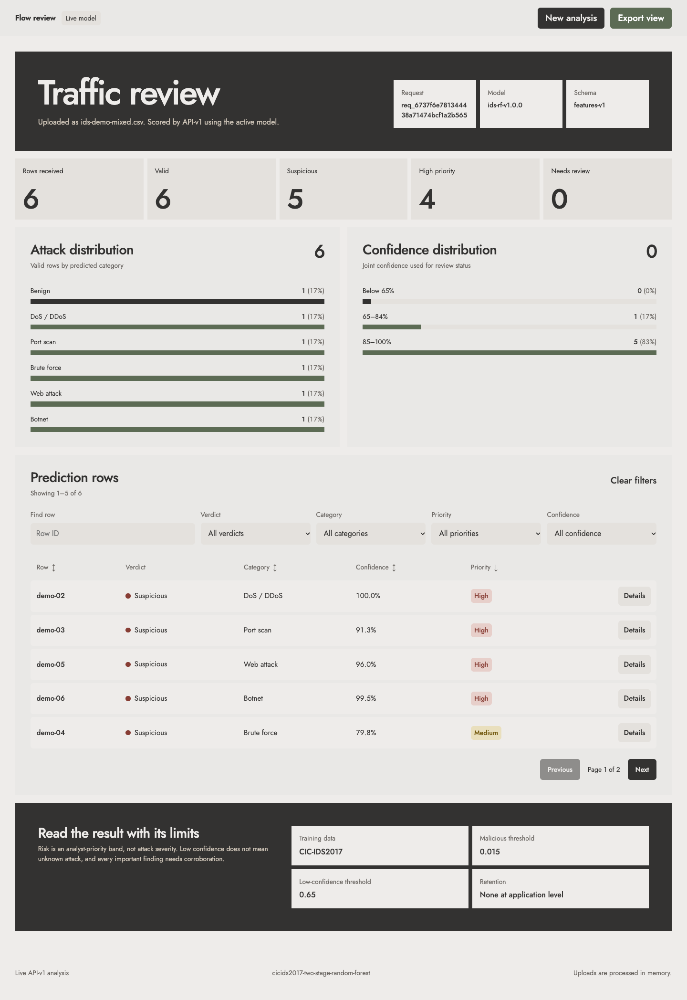
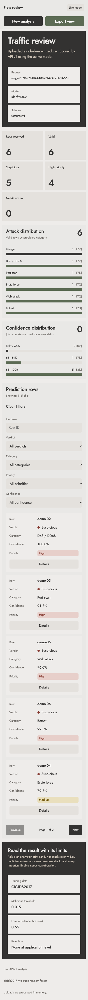

# Architecture and data flow

The MVP separates offline model creation from stateless online inference. Raw captures,
processed splits, and trained artifacts are never served by the frontend and are not
committed to Git.

## Offline training path

```mermaid
flowchart LR
    A[CIC-IDS2017 archive] --> B[Checksum manifest]
    B --> C[Streaming audit]
    C --> D[Global deduplication]
    D --> E[Grouped train and holdouts]
    E --> F[Train-fitted transforms]
    F --> G[Baselines and candidate selection]
    G --> H[Calibration and frozen thresholds]
    H --> I[One-time final test]
    I --> J[Six-file model artifact]
    J --> K[Manifest hashes]
```

The split is assigned before model fitting. Imputation, model fitting, calibration, and
threshold selection use only their declared training or validation partitions. The
final test is opened once after selection is frozen.

## Online request path

The request is processed synchronously in memory. Neither service writes upload rows to
disk or a database. The browser holds the current result only until the page is reset or
closed.

## Deployment and trust boundaries

- The uploaded feature batch is untrusted and is bounded before inference.
- The `joblib` artifact is trusted deployment code-like input. Hash verification detects
  corruption but cannot make an untrusted pickle safe.
- Compose publishes the demo ports directly. An internet-facing deployment requires a
  separate authenticated, authorized, TLS-terminating, rate-limiting gateway.
- Both containers run without root, capabilities, or writable root filesystems and use
  explicit CPU, memory, PID, and temporary-storage limits.

## Component inventory

| Component | Responsibility | Persistent state |
|---|---|---|
| `ml/` package | Audit, split, preprocess, evaluate, calibrate, package | Generated data/model files outside Git |
| FastAPI service | Readiness, metadata, validation, inference, safe errors | None |
| React application | Upload, review, filter, detail, and CSV export | Current browser memory only |
| Nginx | Static delivery, security headers, same-origin API proxy | None |
| Model directory | Frozen pipeline, schemas, metrics, and manifest | Read-only deployment input |

Contract changes flow from the versioned feature and label files into the artifact, API,
frontend fixtures, and tests. A change to an earlier contract reopens that phase and all
downstream gates.

## Reviewed interface evidence

The release uses the Phase 8 live-model screenshots approved after desktop, tablet, and
mobile browser inspection:

